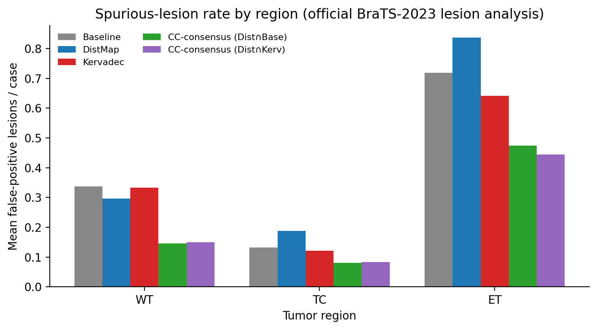

```{=latex}
\clearpage
```

# Precision Pays: A Fixed-Weight Boundary Loss Anchors the Precision End of a Recall–Precision Axis and Wins as the Consensus Veto under the Official BraTS-2023 Metrics

**Guillaume Cassez · Stanislas Larnier**

Independent research

*Guillaume Cassez* — [ORCID 0009-0007-0987-3931](https://orcid.org/0009-0007-0987-3931) · `cassez.guillaume@gmail.com` · [guillaume-cassez.fr](https://guillaume-cassez.fr)  
*Stanislas Larnier* — `stanislaslarnier@gmail.com` · [HAL stanislas-larnier](https://cv.hal.science/stanislas-larnier)

> **Version 2.6 (2026-09-22) — measured provenance of the 55 exclusions, two statistics
> restated at full precision.** No reported result changes.
>
> *Provenance.* §3.1 read "1251 cases" while every statistic in this paper is computed on the
> nnU-Net study set of **1196**; the wording invited the reading that 1251 cases had been trained
> on. §3.1 now separates the download (1251 unified cases) from the study set (1196) and points at
> `analysis/DATASET_EXCLUSIONS.md`, which lists the 55 dropped cases one by one — trigger, git date
> of the triggering entry, and a re-measurement of their file integrity (55 excluded against 55
> included controls: 0 unreadable file, 0 NaN/Inf, 0 out-of-set label, 0 divergent affine,
> (240, 240, 155) everywhere). The exclusion is a conservative, patient-level precaution recorded
> in March 2026, upstream of every training run and every metric; the French mirror ships as
> `analysis/DATASET_EXCLUSIONS_fr.md` with its CSV `analysis/exclusions_1251_to_1196.csv`.
>
> *Statistics restated (§4.4).* The multi-seed nnU-Net validation Dice of the boundary loss is
> 0.9060 ± 0.0018 (per-seed 0.9062 / 0.9078 / 0.9042), previously printed as 0.9061 ±
> 0.0018 — the mean of per-seed values already rounded to 4 decimals — and its paired t-test
> against the baseline (0.9074 ± 0.0007) gives t = −1.02, p = 0.42, where
> the previously printed t = 0.96, p = 0.44 came from running that same test
> on values rounded first. Both readings sit far from significance (df = 2), so no conclusion
> changes; `data/nnunet_validation_dice_multiseed.json` now carries the six training-log
> measurements and both calculations.
>
> *Archive self-containment.* Every path quoted in the manuscript resolves inside this archive: the
> trailing `References:` pointer named a path that does not exist here (`../references.bib` ->
> `references.bib`), and the three pinned-case figures now cite
> `data/patient_level_clean_BKD.json`, the artefact carrying the patient-level counts they quote.
>
> **Version 2.5 (2026-09-21) — author contributions.** No number changed. An **Author
> contributions** section was added after §7, declaring the same roles as in Papers 1 and 3
> (G.C.: study design, training, evaluations and analyses, writing; S.L.: research questions,
> methodological guidance, reviews of successive drafts). This banner is added now because the
> section went in without one — the public changelog did not describe the artefact.
>
> **Version 2.4 (2026-09-19) — title tightened, layout rules.** No number changed. The hook is
> unchanged; the subtitle is shortened. The title block now starts a fresh page — it is never
> split across two pages — and the References are rendered at the end of the PDF (citations
> resolved from `references.bib`; no raw citation marker is left in the text). The section
> plan already matches the common skeleton shared with Papers 1 and 3 (Methods including
> Dataset and Evaluation, Results, Discussion, standalone Limitations, Conclusion).
>
> **Version 2.3 (2026-09-01) — authors and title.** No number changed. By agreement between the
> two authors, Guillaume Cassez is first author and Stanislas Larnier second. The title now leads
> with what the loss buys — the precision end of the axis and the winning veto — the null result
> for the loss alone is stated inside the paper, not in its headline.
>
> **Version 2.2 (2026-08-22) — pre-review pass.** No number changed. Author identifiers
> completed (Stanislas Larnier: HAL IdHAL `stanislas-larnier`; Guillaume Cassez: ORCID
> 0009-0007-0987-3931). The consensus results in the abstract and introduction now state their
> population: K∩B figures come from the multiseed protocol (3 seeds × fold 0, pooled n = 720),
> the D∩K veto figure from the full 5-fold CV (n = 1196). Program-wide method confirmed on
> 2026-08-22: 3 seeds and 5 folds for every paper.
>
> **Version 2.1 (2026-08-11) — editorial pass.** No number changed. The abstract now leads with
> the consensus result, which is the only significant finding of the study, and the null result
> for the boundary loss alone follows it; the trade the paper documents — locate the loss on the
> recall/precision axis, then spend it on agreement — is stated up front.
>
> **Version 2 (2026-06-14) — changelog.** Supersedes v1. Evaluation redone under the **official
> BraTS-2023 metrics** at 300-epoch convergence on the full 5-fold CV (n = 1196). The boundary
> loss is **not significant vs the baseline** on any official metric; its distinctive trait is
> being the precision end of a recall/precision axis. New: we show Kervadec is an effective
> **veto** in the CC-consensus of the companion DistMap paper (its high specificity preserves
> recall as a veto). Added (2026-06-14): a **multiseed analysis** (3 seeds × fold 0, §4.4) that
> confirms the null-vs-baseline result, shows Kervadec **regularises** lesion-wise inter-seed
> variance (opposite of DistMap), and shows the K∩B consensus reproduces Paper 1's D∩B lesion-wise
> WT gain. Conclusions revised. (Concept DOI resolves to this version.)

> Working draft — Paper 2 of the BRATS auxiliary-loss program. Quantitative claims come from
> `code/paper_stats.py` (`data/cv_paper_stats.json`); tables from
> `code/make_tables.py` (`table_paper2.{md,tex}`); figures from `code/make_figures.py`.
> Every official BraTS-2023 metric is reported; a pre-specified primary endpoint is separated
> from exploratory analyses; a non-significant / negative result is reported as such.

## Abstract

**Two models that must agree beat either of them alone.** Under the official BraTS-2023
lesion-wise metrics, a parameter-free connected-component consensus — keep only the tumour
components on which two models concur — removes about half of one model's false-positive lesions
and produces the only significant improvements in this study: whole-tumour lesion-wise Dice
**+3.89 pp** (p = 0.005) and HD95 **−15.66 mm** (p = 0.001) for the Kervadec∩baseline filter
(3 seeds × fold 0, pooled n = 720), and HD95 **−9.95 mm** (p = 2.3×10⁻²⁰; 5-fold CV, n = 1196)
when the boundary-loss model vetoes the distance-map model of the companion Paper 1. The gain
costs no training, no learned parameter and no hyper-parameter: it
is the agreement that does the work, and it reproduces across both auxiliary losses (K∩B mirrors
Paper 1's D∩B, +4.28 pp / −17.2 mm), which is what identifies the mechanism rather than the
ingredient.

**The ingredient itself is null, and we report that in full.** The boundary loss of Kervadec et
al. [@kervadec2019boundary; @kervadec2021boundary] is designed to reduce contour error in highly
unbalanced segmentation. We test whether adding it (fixed weight λ = 0.05, acting directly on the
logits, no auxiliary head) to a strong MedNeXt/nnU-Net backbone improves adult glioma
segmentation, evaluated under the **complete** official BraTS-2023 metric set over a 5-fold
held-out cross-validation (n = 1196). Against the baseline, the boundary loss is **not significant
on the pre-specified primary endpoints** (lesion-wise Dice Δ = +0.000, Holm p = 0.34; lesion-wise
HD95 Δ = −0.58 mm, Holm p = 0.31), **Dice-neutral** on legacy overlap (avg Δ = +0.000, p = 0.06),
**null on legacy region HD95** (avg Δ = −0.09 mm, p = 0.11), and **detection-neutral** (region
sensitivity p = 0.26, specificity p = 0.08). In short, a fixed-weight boundary penalty is
statistically indistinguishable from the baseline on a backbone that already has deep supervision
— a negative result reported here in full, with a weight-selection robustness check that rules out
mistuning.

**What the loss is good for is being a veto.** Its one distinctive, robust standalone property
appears **relative to a signed-distance (SDT) auxiliary head**: the boundary loss is significantly
**more specific** (region specificity r = +0.27, p = 2.6×10⁻¹⁶) and produces **fewer spurious
tumour-core/enhancing lesions** (FP lesions TC Δ = −0.066, ET Δ = −0.195, both Holm p = 0.004), at
a sensitivity cost — the mirror image of the SDT head's recall bias. That precision is exactly
what makes it an effective corroborator: as a veto it removes false-positive lesions while barely
touching recall (0.006 added missed lesions per case against 0.009 for a baseline veto). An
independent **multiseed** analysis (3 seeds × fold 0) confirms the null-vs-baseline result
(t-test p = 0.42) and shows the boundary loss **regularises** lesion-wise inter-seed variance
(σ LW Dice 3–12× lower than baseline by region) — the opposite of DistMap. The practical reading:
locate an auxiliary loss on the recall–precision axis, then spend it on agreement rather than on
the leaderboard.

## 1. Introduction

Requiring two segmentation models to *agree* can be worth more than either model on its own. Under
the official BraTS-2023 lesion-wise metrics, a connected-component consensus — keep only the tumor
components on which two models concur — removes about half of one model's false-positive lesions
and yields a significant whole-tumor gain: lesion-wise Dice **+3.89 pp** (p = 0.005) and HD95
**−15.66 mm** (p = 0.001) for the Kervadec∩baseline filter (3 seeds × fold 0, pooled n = 720),
and **−9.95 mm** HD95 (p = 2.3×10⁻²⁰; 5-fold CV, n = 1196) when the boundary-loss model instead
vetoes the distance-map model of the companion Paper 1. We lead with this because it is the finding
that moves the clinically relevant,
lesion-level metric.

The improvement comes from the agreement, not from any single loss. The lesion-wise metric
penalises each spurious component individually, so discarding components that a second model does
not support is precisely the operation it rewards. The boundary loss contributes here through one
specific, robust property — high specificity — which makes it an effective **veto**: it removes
false-positive lesions while barely touching recall (0.006 added missed lesions per case versus
0.009 for a baseline veto). The gain is carried by the consensus rule and holds regardless of
which auxiliary loss is the primary model — K∩B mirrors Paper 1's D∩B (+4.28 pp / −17.2 mm) — which
indicates the mechanism, rather than the loss term, is doing the work.

The honest twist is that **neither model, taken on its own, significantly improves anything.** The
boundary loss [@kervadec2019boundary; @kervadec2021boundary] — a level-set contour penalty that
has helped weak baselines — adds nothing measurable when bolted onto a **modern, strong** 3D
backbone (MedNeXt [@roy2023mednext] within nnU-Net [@isensee2021nnunet]) that already has deep
supervision and a Dice + cross-entropy objective: against the baseline it is not significant on
any pre-specified primary or region-averaged official metric (lesion-wise Dice Δ = +0.000, Holm
p = 0.34; lesion-wise HD95 Δ = −0.58 mm, p = 0.31), and a multiseed check (3 seeds × fold 0)
confirms the null (t-test p = 0.42). The value is not in the ingredient but in the agreement.

We therefore report, honestly and in full, both sides: a transparent negative result for the
fixed-weight boundary loss on its own — guarded against the mistuning objection by a
weight-selection robustness check — and the mechanism-level finding that its precision makes it a
useful consensus component. Contributions:
1. A convergence-time, 5-fold evaluation (n = 1196) of a fixed-weight boundary loss on a strong 3D
   glioma backbone under the complete official BraTS-2023 metric set — a transparently reported
   **negative result** over the baseline, with a robustness check ruling out weight mistuning.
2. The one robust standalone signal — that the boundary loss is the **precision-oriented**
   counterpart of an SDT auxiliary head (significantly more specific, fewer spurious TC/ET lesions,
   lower sensitivity) — locating both auxiliary losses on a single recall–precision axis.
3. The consensus finding: Kervadec's specificity makes it an effective veto (D∩K) and a viable
   primary model (K∩B) in a connected-component consensus that significantly improves the
   lesion-wise whole-tumor metrics, with the gain attributable to the agreement mechanism rather
   than the loss.

## 2. Related work
Boundary-integral losses [@kervadec2019boundary; @kervadec2021boundary] vs distance-map
regression [@ma2020distance; @xue2020shapeaware; @dangi2019distance] are two families of
shape/boundary-aware objectives; the companion Paper 1 studies the latter. Backbone and training:
nnU-Net [@isensee2021nnunet], MedNeXt [@roy2023mednext], Dice/GDL [@milletari2016vnet;
@sudre2017generalised]. Data and metrics: BraTS [@menze2015brats; @bakas2017advancing;
@baid2021rsna]; lesion-wise metrics [@moawad2023bratsmets; @saluja2023bratsmetrics]; surface
distance [@nikolov2021clinically].

## 3. Methods

### 3.1 Dataset and backbone
Identical to the companion Paper 1. **Data.** BraTS-2023 adult glioma (GLI) [@baid2021rsna]:
**1251 unified cases downloaded, 1196 in the study set** — the study set is what every training run
and every metric below uses. The 55 dropped cases are listed one by one (trigger, git date of the
triggering entry, re-measurement of their file integrity: 55 excluded vs 55 included controls,
0 unreadable file, 0 NaN/Inf, 0 out-of-set label, 0 divergent affine) in
`analysis/DATASET_EXCLUSIONS.md`. The drop is a patient-level precaution recorded in March 2026,
upstream of any training run and any metric; no published figure changes. **Backbone.** Official
nnU-Net 5-fold splits, MedNeXt-B via nnU-Net v2 (`3d_fullres`, `nnUNetPlans_96GB_mednext`),
Dice + cross-entropy with deep supervision, 300 epochs/fold, RTX PRO 6000. All methods share folds
(paired statistics, n = 1196).

### 3.2 Boundary loss
We add the Kervadec boundary term as `seg_loss + λ · mean(softmax(logits) · SDT_signed)`
(θ₀ = 30, fixed λ = 0.05), acting directly on the segmentation logits with **no auxiliary head**.
Implementation: `code/nnUNetTrainerMedNeXtKervadec.py`; signed SDT cache precomputed for
all cases.

### 3.3 Weight selection and robustness
λ ∈ {0.05, 0.15, 0.5, 1.5, 5.0} was screened on a short schedule (50 epochs, fold 0); λ = 0.05
maximised EMA pseudo-Dice. Because that criterion is overlap-based, we additionally re-rank the
screening on sentinel-capped HD95 (median + mean): λ = 0.05 is already near HD95-optimal (lowest
whole-tumor median HD95, fewest catastrophic misses), and larger λ **degrades** HD95 (median
rises monotonically; λ = 5.0 collapses). The null region-wise result below is therefore not a
weight-selection artefact.

### 3.4 Evaluation
Identical official-metric protocol and statistics as Paper 1 (official BraTS-2023-Metrics, GLI
parameters; paired two-sided Wilcoxon; rank-biserial r with + favoring Kervadec and its bootstrap
CI; Holm correction across regions; Benjamini–Hochberg FDR across the whole 216-test exploratory
family; pre-specified primary endpoint = the two region-averaged official ranking metrics). We evaluate both Kervadec vs baseline and Kervadec vs
the SDT head (DistMap). Pipeline: `code/eval_lesionwise_kervadec.py` → `code/paper_stats.py`.

## 4. Results

### 4.1 Versus baseline — no significant effect anywhere central
- **Primary endpoints (null):** lesion-wise Dice Δ = +0.000 (Holm p = 0.34); lesion-wise HD95
  Δ = −0.58 mm (r = +0.06, raw p = 0.155, Holm p = 0.31).
- **Overlap (Dice-neutral):** legacy Dice avg Δ = +0.000 (p = 0.063; Table 1). A single nominal effect —
  tumor-core legacy Dice Δ = +0.001 (p = 0.005, Holm 0.015†) — is statistically significant but
  negligible in magnitude.
- **Boundary (null):** legacy region HD95 avg Δ = −0.09 mm (r = +0.07, p = 0.109).
- **Detection (neutral):** region sensitivity avg Δ = −0.001 (p = 0.256); specificity avg
  Δ = +0.000 (r = +0.06, p = 0.079). Lesion FP/FN counts vs baseline are all non-significant
  (Table 2). The boundary loss does not separate from the baseline.


**Pre-specified primary endpoints** (Kervadec vs Baseline, region-averaged official ranking metrics, Holm-corrected across the 2-metric family):

- Lesion-wise Dice: Δ = +0.000, r = +0.032, raw p = 0.339, Holm p = 0.339 → not significant
- Lesion-wise HD95: Δ = -0.582 mm, r = +0.056, raw p = 0.155, Holm p = 0.311 → not significant


```{=latex}
\needspace{29\baselineskip}
```

**Table 1 — Official ranking & legacy metrics (Kervadec vs Baseline)**

Δ = Kervadec − Baseline. r = matched-pairs rank-biserial (+ favours Kervadec). \* raw p<0.05; † Holm-corrected p<0.05 (across the 3 regions). n=1196.

| Metric | Region | Kervadec | Baseline | Δ | r | win/loss | p | p(Holm) |
|---|---|---|---|---|---|---|---|---|
| Lesion-wise Dice | WT | 0.811 | 0.812 | -0.001 | +0.03 | 614/580 | 0.352 | 0.658 |
|  | TC | 0.869 | 0.870 | -0.001 | +0.07 | 643/543 | 0.039* | 0.118 |
|  | ET | 0.800 | 0.798 | +0.003 | +0.03 | 603/557 | 0.329 | 0.658 |
|  | avg | 0.827 | 0.826 | +0.000 | +0.03 | 635/559 | 0.339 | -- |
| Lesion-wise HD95 (mm) | WT | 53.87 | 53.09 | +0.78 | +0.06 | 337/289 | 0.216 | 0.631 |
|  | TC | 24.33 | 24.68 | -0.35 | -0.01 | 222/225 | 0.889 | 0.889 |
|  | ET | 42.71 | 44.89 | -2.18 | +0.07 | 200/173 | 0.210 | 0.631 |
|  | avg | 40.31 | 40.89 | -0.58 | +0.06 | 458/388 | 0.155 | -- |
| Legacy Dice | WT | 0.936 | 0.935 | +0.000 | +0.03 | 619/575 | 0.397 | 0.648 |
|  | TC | 0.918 | 0.918 | +0.001 | +0.09 | 645/542 | 0.005* | 0.015† |
|  | ET | 0.870 | 0.869 | +0.000 | +0.03 | 606/557 | 0.324 | 0.648 |
|  | avg | 0.908 | 0.907 | +0.000 | +0.06 | 646/548 | 0.063 | -- |
| Legacy HD95 (mm) | WT | 5.77 | 5.79 | -0.02 | +0.06 | 291/269 | 0.252 | 0.589 |
|  | TC | 6.02 | 6.00 | +0.01 | +0.06 | 214/199 | 0.282 | 0.589 |
|  | ET | 11.36 | 11.62 | -0.26 | +0.08 | 172/145 | 0.196 | 0.589 |
|  | avg | 7.72 | 7.81 | -0.09 | +0.07 | 420/354 | 0.109 | -- |


```{=latex}
\needspace{29\baselineskip}
```

**Table 2 — Lesion detection (Kervadec vs Baseline)**

Δ = Kervadec − Baseline. r = matched-pairs rank-biserial (+ favours Kervadec). \* raw p<0.05; † Holm-corrected p<0.05 (across the 3 regions). n=1196.

| Metric | Region | Kervadec | Baseline | Δ | r | win/loss | p | p(Holm) |
|---|---|---|---|---|---|---|---|---|
| FP lesions | WT | 0.334 | 0.337 | -0.003 | +0.00 | 112/112 | 0.945 | 1.000 |
|  | TC | 0.122 | 0.132 | -0.010 | -0.02 | 38/46 | 0.725 | 1.000 |
|  | ET | 0.641 | 0.718 | -0.077 | +0.14 | 80/74 | 0.158 | 0.474 |
|  | avg | 0.366 | 0.396 | -0.030 | +0.02 | 172/176 | 0.777 | -- |
| FN lesions | WT | 0.079 | 0.080 | -0.001 | +0.11 | 5/4 | 0.739 | 0.739 |
|  | TC | 0.033 | 0.037 | -0.003 | +0.43 | 5/2 | 0.206 | 0.412 |
|  | ET | 0.038 | 0.042 | -0.004 | +0.56 | 6/2 | 0.132 | 0.395 |
|  | avg | 0.050 | 0.053 | -0.003 | +0.37 | 10/7 | 0.244 | -- |
| Sensitivity | WT | 0.929 | 0.929 | -0.000 | -0.03 | 574/618 | 0.438 | 0.438 |
|  | TC | 0.919 | 0.921 | -0.002 | +0.04 | 636/544 | 0.193 | 0.386 |
|  | ET | 0.876 | 0.877 | -0.000 | +0.07 | 623/532 | 0.051 | 0.154 |
|  | avg | 0.908 | 0.909 | -0.001 | +0.04 | 627/567 | 0.256 | -- |
| Specificity | WT | 1.000 | 1.000 | +0.000 | +0.07 | 626/566 | 0.039* | 0.118 |
|  | TC | 1.000 | 1.000 | +0.000 | +0.00 | 573/607 | 0.908 | 0.908 |
|  | ET | 1.000 | 1.000 | -0.000 | -0.04 | 584/593 | 0.259 | 0.517 |
|  | avg | 1.000 | 1.000 | +0.000 | +0.06 | 616/578 | 0.079 | -- |


### 4.2 Versus the SDT head — a precision-oriented mirror (exploratory, robust)
The boundary loss differs sharply from the SDT auxiliary head (Table 3–4, Fig. 1–2):
- **More specific:** region specificity r = +0.27 (avg **p = 2.6×10⁻¹⁶**; all regions Holm†).
- **Fewer spurious lesions:** FP lesions TC Δ = −0.066 (p = 0.002, Holm 0.004†), ET Δ = −0.195
  (p = 0.001, Holm 0.004†).
- **Lower sensitivity / more missed lesions:** region sensitivity r = −0.18 (avg p = 1.1×10⁻⁷).
- **Better enhancing-tumor lesion-wise HD95:** Δ = −4.05 mm (p = 0.015, Holm 0.046†) and
  lesion-wise ET Dice Δ = +0.008 (p = 0.020).

The boundary loss thus occupies the **precision** end of a recall–precision axis whose recall end
is the SDT head (Paper 1); neither beats the baseline on the official ranking metrics.


**Pre-specified primary endpoints** (Kervadec vs DistMap, region-averaged official ranking metrics, Holm-corrected across the 2-metric family):

- Lesion-wise Dice: Δ = +0.003, r = +0.033, raw p = 0.324, Holm p = 0.647 → not significant
- Lesion-wise HD95: Δ = -1.700 mm, r = +0.027, raw p = 0.487, Holm p = 0.647 → not significant


```{=latex}
\needspace{29\baselineskip}
```

**Table 3 — Official ranking & legacy metrics (Kervadec vs DistMap)**

Δ = Kervadec − DistMap. r = matched-pairs rank-biserial (+ favours Kervadec). \* raw p<0.05; † Holm-corrected p<0.05 (across the 3 regions). n=1196.

| Metric | Region | Kervadec | DistMap | Δ | r | win/loss | p | p(Holm) |
|---|---|---|---|---|---|---|---|---|
| Lesion-wise Dice | WT | 0.811 | 0.816 | -0.005 | -0.01 | 606/589 | 0.785 | 0.785 |
|  | TC | 0.869 | 0.862 | +0.008 | +0.05 | 613/576 | 0.161 | 0.323 |
|  | ET | 0.800 | 0.792 | +0.008 | +0.08 | 618/545 | 0.020* | 0.061 |
|  | avg | 0.827 | 0.823 | +0.003 | +0.03 | 616/579 | 0.324 | -- |
| Lesion-wise HD95 (mm) | WT | 53.87 | 51.11 | +2.76 | -0.03 | 328/332 | 0.486 | 0.971 |
|  | TC | 24.33 | 28.14 | -3.81 | +0.03 | 225/232 | 0.626 | 0.971 |
|  | ET | 42.71 | 46.76 | -4.05 | +0.14 | 231/193 | 0.015* | 0.046† |
|  | avg | 40.31 | 42.01 | -1.70 | +0.03 | 450/418 | 0.487 | -- |
| Legacy Dice | WT | 0.936 | 0.936 | -0.000 | +0.01 | 607/588 | 0.786 | 0.786 |
|  | TC | 0.918 | 0.917 | +0.001 | +0.05 | 617/572 | 0.111 | 0.332 |
|  | ET | 0.870 | 0.871 | -0.001 | +0.05 | 612/553 | 0.158 | 0.332 |
|  | avg | 0.908 | 0.908 | -0.000 | +0.03 | 616/579 | 0.362 | -- |
| Legacy HD95 (mm) | WT | 5.77 | 5.51 | +0.26 | -0.01 | 284/292 | 0.838 | 1.000 |
|  | TC | 6.02 | 5.89 | +0.13 | -0.05 | 206/222 | 0.384 | 1.000 |
|  | ET | 11.36 | 11.54 | -0.18 | +0.01 | 183/174 | 0.873 | 1.000 |
|  | avg | 7.72 | 7.65 | +0.07 | -0.02 | 400/393 | 0.646 | -- |


```{=latex}
\needspace{29\baselineskip}
```

**Table 4 — Lesion detection (Kervadec vs DistMap)**

Δ = Kervadec − DistMap. r = matched-pairs rank-biserial (+ favours Kervadec). \* raw p<0.05; † Holm-corrected p<0.05 (across the 3 regions). n=1196.

| Metric | Region | Kervadec | DistMap | Δ | r | win/loss | p | p(Holm) |
|---|---|---|---|---|---|---|---|---|
| FP lesions | WT | 0.334 | 0.297 | +0.037 | -0.10 | 116/132 | 0.131 | 0.131 |
|  | TC | 0.122 | 0.188 | -0.066 | +0.39 | 61/34 | 0.002* | 0.004† |
|  | ET | 0.641 | 0.836 | -0.195 | +0.26 | 110/73 | 0.001* | 0.004† |
|  | avg | 0.366 | 0.440 | -0.075 | +0.08 | 206/185 | 0.123 | -- |
| FN lesions | WT | 0.079 | 0.075 | +0.004 | -0.34 | 4/9 | 0.166 | 0.472 |
|  | TC | 0.033 | 0.030 | +0.003 | -0.50 | 2/6 | 0.157 | 0.472 |
|  | ET | 0.038 | 0.035 | +0.003 | -0.03 | 4/7 | 0.366 | 0.472 |
|  | avg | 0.050 | 0.047 | +0.003 | -0.30 | 10/16 | 0.064 | -- |
| Sensitivity | WT | 0.929 | 0.931 | -0.002 | -0.20 | 486/706 | 2.4e-09* | 7.3e-09† |
|  | TC | 0.919 | 0.921 | -0.002 | -0.08 | 551/631 | 0.018* | 0.018† |
|  | ET | 0.876 | 0.880 | -0.004 | -0.15 | 494/659 | 1.6e-05* | 3.2e-05† |
|  | avg | 0.908 | 0.910 | -0.002 | -0.18 | 495/700 | 1.1e-07* | -- |
| Specificity | WT | 1.000 | 1.000 | +0.000 | +0.25 | 705/488 | 1.2e-13* | 3.5e-13† |
|  | TC | 1.000 | 1.000 | +0.000 | +0.17 | 654/529 | 6.6e-07* | 6.6e-07† |
|  | ET | 1.000 | 1.000 | +0.000 | +0.23 | 684/498 | 3.2e-12* | 6.5e-12† |
|  | avg | 1.000 | 1.000 | +0.000 | +0.27 | 732/463 | 2.6e-16* | -- |


\clearpage

{width=85%}

\clearpage

{width=85%}

Three pinned patients of the companion 3D viewer (https://guillaume-cassez.fr/imagerie-medicale/brats/2023-distance-map/viewer/, official regime: white background, BraTS-2023 component cleaning, viewer region colors) put faces on these patient-level counts: a case the boundary loss rescues when both other models fail (Figure 3), a case it fails and the baseline dominates (Figure 4), and a case the SDT head rescues (Figure 5).

\clearpage

![Figure 3 — Pinned case P2A (`BraTS-GLI-01486-000`, fold 1): **Kervadec rescues.** Kervadec (0.822) ≫ Baseline (0.526) > DistMap (0.324): the boundary loss captures the tumor where both others fail — 415/1196 patients (34.7 %) see Kervadec beat both Baseline and DistMap on lesion-wise Dice (official clean regime, mean over the 3 regions). Patient-level counts and pinned-case scores: `data/patient_level_clean_BKD.json`. Exact rendering of the companion 3D viewer: white background, official filter, sagittal view, brain masked.](figures/figviewer_P2A_kervadec_sauve.png){width=100%}

\clearpage

{width=100%}

\clearpage

{width=100%}


### 4.3 Kervadec as a consensus veto
Its high specificity makes Kervadec an effective veto in the CC-consensus studied in the companion
DistMap paper. Filtering DistMap's components by Kervadec agreement (`CC(D∩K)`) removes ~half of
DistMap's false-positive lesions (0.44 → 0.23/case) while preserving recall marginally better than
a baseline veto (added missed lesions 0.006 vs 0.009/case), and yields a configuration that
significantly beats the baseline on the official ranking metrics (lesion-wise HD95 −9.95 mm,
p = 2.3×10⁻²⁰). The boundary loss thus contributes not as a standalone improvement but as a
precision-oriented veto component — its high specificity is exactly the property a veto needs.

### 4.4 Seed robustness (3 seeds, fold 0)
The CV evaluation (§4.1–4.3) uses seed 42 across all 5 folds. To separate a robust signal from an
initialisation fluctuation and to measure the boundary loss's inter-seed variance, three independent
trainings (seeds 1, 2, 3) were run for baseline and Kervadec (λ = 0.05) on fold 0 (n ≈ 240),
300 epochs each — mirroring the companion DistMap multiseed protocol (Paper 1, §4.6). Source:
`code/evaluate_multiseed_kervadec.py` (`data/multiseed_stats.json`).

- **Null vs baseline, again.** nnU-Net validation Dice: baseline 0.9074 ± 0.0007 vs Kervadec
  0.9060 ± 0.0018 (per-seed 0.9062 / 0.9078 / 0.9042); paired t-test t = −1.02,
  p = 0.42 at full precision — artefact `data/nnunet_validation_dice_multiseed.json`, which
  reads the six training logs and carries both calculations (the rounded-input one, quoted before
  v2.6, and this one). Under the
  official metrics, Kervadec and baseline stay indistinguishable on legacy Dice (all p > 0.40
  Wilcoxon). Two sub-significant trends favour better boundary placement: LW HD95 WT −5.35 mm
  (p = 0.058) and TC −4.39 mm (p = 0.099).
- **Kervadec regularises lesion-wise variance.** On overlap Dice the three configs are comparably
  stable; but on the official lesion-wise metrics Kervadec's inter-seed σ is markedly **lower** than
  baseline — σ(LW Dice) 0.0080→0.0021 (WT, ×3.9), 0.0067→0.0024 (TC, ×2.8), 0.0109→0.0009 (ET, ×12).
  This is the **opposite** of DistMap, which was more unstable than baseline on the same protocol
  (Paper 1, §4.6). Suppressing spurious components tightens the lesion-wise spread — the signature of
  the loss's precision bias (§4.2).
- **K∩B consensus reproduces the D∩B gain.** Keeping Kervadec connected components overlapping a
  baseline prediction (K∩B) significantly improves LW Dice WT (+3.89 pp, p = 0.005 Wilcoxon) and LW
  HD95 WT (−15.66 mm, p = 0.001), at no legacy-Dice cost — close to the D∩B gain on the same
  protocol (Paper 1, §4.6: +4.28 pp / −17.2 mm). The connected-component consensus rule produces the
  lesion-wise WT improvement **regardless of which auxiliary loss is the primary model**: the gain is
  carried by the consensus mechanism, not the loss. This complements §4.3 — Kervadec is useful in
  consensus both as a **veto** (D∩K, filtering DistMap) and as a **primary model** (K∩B, filtered by
  baseline).

## 5. Discussion

**A fixed-weight boundary loss does not help a strong backbone.** With deep supervision and a
combined Dice + CE objective already present, an added contour penalty leaves overlap, region
boundary, and detection unchanged relative to the baseline. This is a useful negative result that
bounds the expected benefit of bolt-on boundary penalties for state-of-the-art 3D glioma
backbones — reported transparently, with a weight-selection robustness check that excludes
mistuning.

**Its distinctive trait is precision, visible only by contrast.** Against the SDT head, the
boundary loss is significantly more specific and produces fewer spurious tumor-core/enhancing
lesions, at a sensitivity cost. Read together with Paper 1, the two auxiliary losses are mirror
images on a recall–precision axis: the SDT head trades specificity for recall, the boundary loss
trades recall for specificity, and neither improves the official ranking metrics over the
baseline. This contrast — not a win over the baseline — is the contribution.

## 6. Limitations
The main comparison (vs baseline) is null; we present it as such. The specificity/FP advantages
hold only against the SDT head and are exploratory (primary endpoints null), though robust
(p ≤ 10⁻⁷, surviving Holm). Region sensitivity/specificity are voxel-level. Fold-0
baseline/DistMap predictions come from a headline run on external media. Only one fixed weight
was carried to full CV, justified by the screening robustness check.

## 7. Conclusion
On a strong MedNeXt/nnU-Net glioma backbone, a fixed-weight Kervadec boundary loss yields **no
significant improvement over the baseline** under any official BraTS-2023 metric. Its only robust,
distinctive property is being the **precision-oriented mirror** of a signed-distance auxiliary
head — more specific, fewer spurious lesions, lower recall — a property that also makes it a
*regulariser* of lesion-wise variance and an effective consensus *veto*. The measurable gain comes
not from the loss but from the connected-component consensus filter, which yields the same
lesion-wise WT improvement whether the loss serves as a veto (D∩K) or as the primary model (K∩B).
Reported in full, this delimits when boundary losses help (not here, over a strong baseline) and
what they actually change (the recall–precision operating point, and training stability).

---

## Author contributions

**Guillaume Cassez** (lead author): study design, model training, evaluations and analyses,
manuscript writing. **Stanislas Larnier**: formulation of the research questions, methodological
guidance, careful reviews of successive drafts of the paper. Both authors approved the final
version and the author order.

---

References: `references.bib` (all verified; shipped in this archive).
